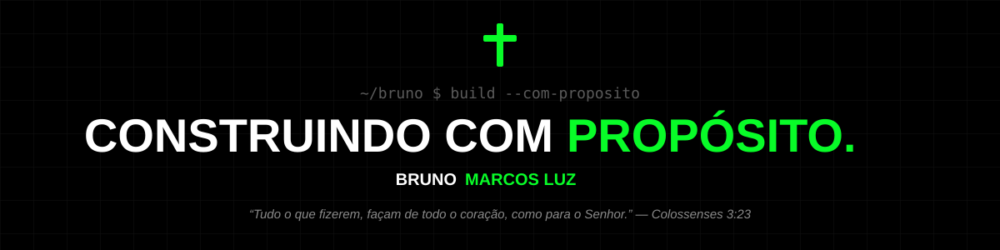

# Bruno Marcos Luz

**Builder · Analista de Desenvolvimento · Fundador da Ambitie Technology**

---

### Quem sou

Sou cristão, irmão mais velho e builder. Acredito que trabalho bem feito também é uma forma de servir: código limpo, sistemas que funcionam e pessoas ajudadas de verdade.

- 🚀 Fundador da **[Ambitie Technology](https://ambitie-tech.vercel.app/)**: produtos e apps para quem quer tirar ideias do papel
- 🎬 Criador de conteúdo sobre **carreira e tecnologia** no [YouTube](https://www.youtube.com/channel/UCMqHKG1_So1rEtcMTMJLqjA), [TikTok](https://www.tiktok.com/@brunomarcosluz) e [Twitter](https://twitter.com/brunomarcosluz)
- 🎤 Palestrante: tecnologia comunicada para pessoas reais
- 🎓 Ciência da Computação (UniMetrocamp Wyden) · ITIL Certified
- 🔭 Aprendendo agora: **Cloud (AWS)** e **arquitetura mobile escalável**

### O que eu uso para construir

  

### No que estou construindo

- **[just-build-apps](https://github.com/brunomarcosluz/just-build-apps)**: apps feitos na prática, do zero ao deploy
- **[readme-templates-bml](https://github.com/brunomarcosluz/readme-templates-bml)**: templates de README para devs

---

*"Tudo o que fizerem, façam de todo o coração, como para o Senhor, e não para os homens."* 
**Colossenses 3:23**

